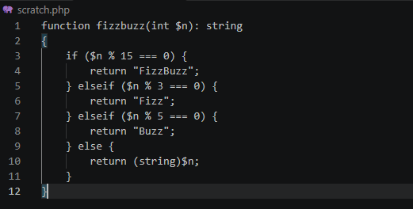

# Lab 0 submission

## Copilot suggestion screenshot

## What the app does

LinkKeeper is a small Laravel 13 bookmark manager used as the starter app for Modules 0–3 of an AI-augmented development course. Each bookmark has a title, a URL, an optional visited_at and a pinned flag, and bookmarks can be tagged. Requests to /bookmarks go through routes/web.php to app/Http/Controllers/BookmarkController.php, which uses the Bookmark and Tag models (app/Models/), cleans up tag names with app/Services/TagNormalizer.php, and renders resources/views/bookmarks/index.blade.php. The repo also has a grading setup: per-module test suites under grading/tests/, a grading/score.py script that uses grading/weights.json to score students' work and their SUBMISSION.md files, and a .github/workflows/grade.yml workflow that runs the grading on GitHub.

## Oddity found

The agent found that BookmarkController::index() sorts pinned bookmarks last and oldest first, even though its docblock and the page header promise "pinned first, newest-first", and that the Bookmark model's docblock claims visited_at is never null while 3 seeded bookmarks have it set to null.
